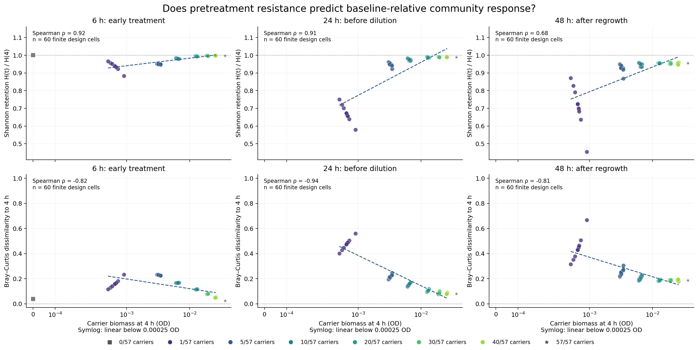
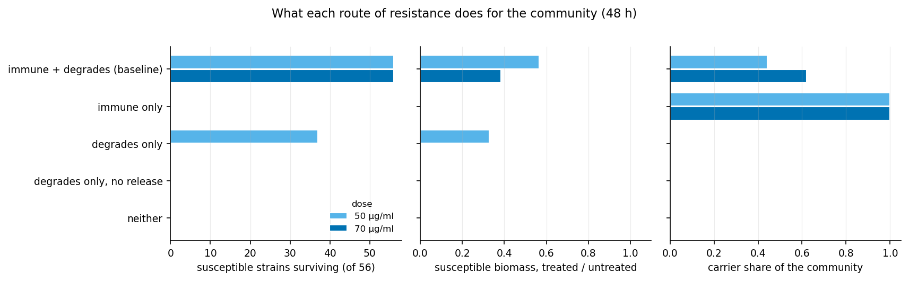
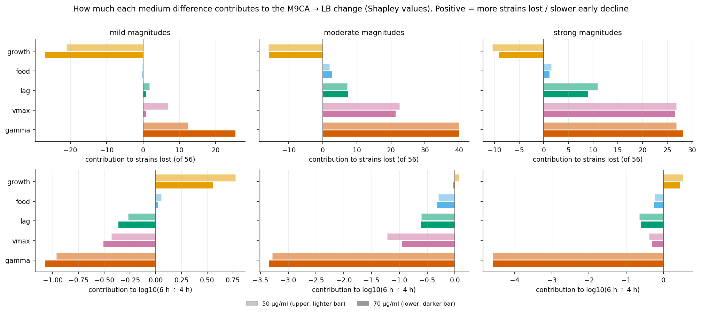
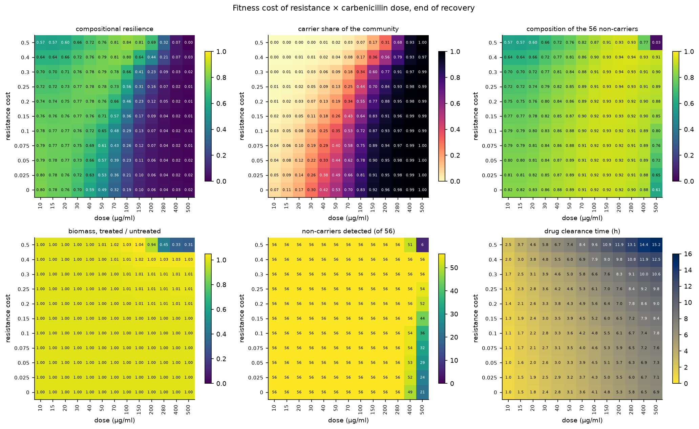

# Consumer-resource model: findings to date

*Status as of 16 Nov 2026. Covers all analyses of `resilience_model.py` (the 57-strain model of the barcoded* E. coli *cross-protection experiment) that are in the repository.*

## Contents

| Analysis | Author | Folder | Detailed write-up |
|---|---|---|---|
| A. Number and identity of resistant strains | Kylie | `test_resistance_distribution/` | notebooks in that folder |
| B. Private vs. public benefit of resistance | Sarvesh | `test_protection_mechanism/` | `REPORT_protection_and_medium.md` §2 |
| C. Medium ablation (M9CA vs. LB) | Sarvesh | `test_medium_ablation/` | `REPORT_protection_and_medium.md` §3 |
| D. Fitness cost × dose; treatment duration | — | `test_cost_and_duration/` | `REPORT_cost_and_duration.md` |

**Common setup.** All three analyses share the same protocol:

- **Community:** 57 strains, with growth rates and IC50s drawn by `seed = 42` unless stated. There are no measured strain traits; see "What this does not cover".
- **Timing:** carbenicillin added at 4 h, 1:100 transfer into drug-free medium at 24 h, readout at 48 h.
- **Dose:** 50 µg/ml unless stated.
- **Carriers:** immune to the drug and degrade it, unless stated.

**Model changes** (needed for B and C; D uses the model unchanged):

- **New terms:** private-protection strength (`carrier_lysis`, Ma et al.'s β), enzyme released by lysed carriers (`free_enzyme_activity` = 0.35, Ma et al.'s κ_b/φ_max), its decay, and a Baranyi–Roberts lag phase (`lag_h`).
- **Backward compatibility:** at their defaults these reproduce the previous model to about 10⁻¹⁴. Analysis A embeds its own copy of the original model, so it is unaffected.
- **Checks:** 20/20 built-in checks pass.

---

## Main conclusions

1. **Resistance protects the community by removing the drug, not by surviving it.**
   - An immune carrier that does not degrade the drug saves no one (B).
   - A single immune degrader saves all 56 susceptible strains (A, B).
   - Degradation without immunity saves some strains at 50 µg/ml and none at 70 µg/ml, mostly through enzyme released by dying carriers (B).

2. **What decides the outcome is how much enzyme is present when the drug arrives, and how fast the drug kills.** All three analyses point to this from different directions:
   - **A:** total carrier biomass at 4 h strongly predicts how much diversity is kept and how little the composition changes, across carrier counts (Spearman ρ ≈ 0.9 at 6–24 h).
   - **B:** a non-immune carrier's rescue tracks its own growth rate (ρ ≈ 0.86 across 12 trait draws), because faster growth means more enzyme by 4 h.
   - **C:** LB's faster growth makes the culture about 31× denser at 4 h, so k30 clears the drug in 0.3 h instead of 3.3 h. Only faster killing per unit growth (`gamma`), weaker enzyme or a lag can undo this.

   This is the lab's "race between detoxification and susceptible loss", made quantitative.

3. **Saving strains and keeping the community's composition are different outcomes, and they trade off against carrier takeover.**
   - **Fast carriers take over more (A).** At a fixed carrier count, more carrier biomass at 4 h means *worse* diversity retention (ρ = −1.00 among single carriers). Every single carrier saves all 56 strains, but the faster-growing ones take over more: their share at 48 h ranges from 0.21 to 0.69, and diversity retention from 0.87 to 0.45. The pooled positive correlation comes from comparing different carrier counts, not from carrier biomass as such.
   - **Partial immunity avoids takeover at moderate doses (B).** A partly protected carrier (`carrier_lysis` ≈ 0.8) rescues everyone at 35–50 µg/ml while ending at only about 3% of the community. The window closes at 70 µg/ml.
   - **Spreading resistance helps (A, B).** It reduces takeover and raises compositional similarity to the untreated community: 0.57 with one carrier, 0.82 with five and 0.93 with forty (A).

4. **In this model, LB's known differences predict better protection in LB, which contradicts the lab (C).** Reproducing the lab's faster 4→6 h decline and lower 48 h richness needs either one large change (`gamma` × 12 or a 4 h lag) or two moderate ones (for example `gamma` × 4 with `vmax` ÷ 10). Killing per unit growth (`gamma`) is the strongest lever, especially for the early decline.

5. **The model's protection assumes the enzyme works close to its physical limit (B).**
   - **Ceiling:** an estimate from TEM-1 abundance and turnover puts the maximum whole-cell degradation rate at about 1–3 × 10⁴ µg/ml/h per OD. The default `vmax` (10⁴) is at that ceiling.
   - **Margin:** at 3 000, an immune carrier still rescues everyone; at 1 000 it saves only 17 of 56.
   - **Consequence:** if k30's real activity is well below its maximum, the model under-protects, and something else must explain the lab's protection.
   - **Fix:** an earlier sweep went to `vmax` = 10⁵, which is not physically attainable. It now stops at 3 × 10⁴, and the conclusions above use only the plausible range.

6. **A strain counted as "lost" may not be extinct (C).** When k30 is more than 99% of the community, other strains can be alive but below the 10⁻⁴ detection limit. Some lab-like scenarios lose strains to true extinction and others only to dominance. Telling them apart needs absolute abundances.

7. **Demographic noise does not matter at the experiment's population sizes (A).** A stochastic version (tau-leaping at 10⁹ cells per OD) gives a run-to-run Shannon SD of about 0.001. Which strains carry resistance matters far more than chance. Sampling at the transfer bottleneck, which could matter, has not been tested.

---

## A. Number and identity of resistant strains (Kylie)

**Design:**
- 0, 1, 5, 10, 20, 30, 40 or 57 carriers.
- 10 random carrier orders at each intermediate count, nested within an order.
- Fixed strain traits, matched untreated controls, 50 µg/ml.
- Four notebooks: a fixed-order baseline, the correlation analysis, an organized presentation version, and a stochastic version (1,240 runs).

| Carriers | Susceptible strains detected at 48 h | Diversity retention, median | Carrier share at 48 h, median |
|---|---|---|---|
| 0 | 0 (community extinct) | — | — |
| 1 | all | 0.71 | 0.43 |
| 5 | all | 0.93 | 0.23 |
| 10 | all | 0.95 | 0.25 |
| 20 | all | 0.95 | 0.36 |
| 40 | all | 0.95 | 0.64 |

- **One carrier is enough to save every strain;** additional carriers improve evenness and composition rather than survival.
- **Pooled correlations with carrier biomass at 4 h** (across counts):

  | Readout | 6 h | 24 h | 48 h |
  |---|---|---|---|
  | Diversity retention | +0.92 | +0.91 | +0.68 |
  | Bray–Curtis change | −0.82 | −0.94 | −0.81 |

  These hold after adjusting for the untreated controls.
- **Within a carrier count the sign reverses**, as described in conclusion 3: faster-growing carriers clear the drug just as well but then outcompete the others. This answers the checklist question *"Does a fast carrier protect better but take over more?"* For an immune carrier: no, and yes.
- **Stochastic version:** with 10 or more carriers, every assignment met Kylie's joint recovery criterion: at 48 h, at least 80% of untreated biomass, at least 90% of untreated Shannon, and Bray–Curtis ≤ 0.2 to untreated. With 5 carriers the success rate averaged 70% and depended on which strains carried resistance. One carrier never met it.

---

## B. Private vs. public benefit (summary)

| Carrier type | 50 µg/ml | 70 µg/ml | Takes over? |
|---|---|---|---|
| Immune + degrades (baseline) | 56/56 survive | 56/56 | yes (share 0.44 / 0.62) |
| Partial protection (`carrier_lysis` 0.8) | 56/56 | 7/56 | no (share 0.03) |
| Degrades only | 37/56 | 0/56 | no |
| Degrades only, no enzyme release | 0/56 | 0/56 | — |
| Immune only | 0/56 | 0/56 | completely |

- **Full-rescue limits:** the immune degrader rescues everyone up to about 280 µg/ml, partial protection to 50 µg/ml, and the non-immune degrader to about 21 µg/ml. The lab's 50 vs. 70 µg/ml comparison sits where these routes diverge.
- **Two non-immune carriers** already rescue every strain at both doses.

---

## C. Medium ablation (summary)

- **Known differences:** LB's faster growth and richer food give a 4→6 h change of ×1.28 against ×0.21 in M9CA, and compositional resilience of 0.96 against 0.57. That is better recovery in LB, the opposite of the lab.
- **Full ablation:** all 32 combinations of five switches (growth, food, lag, `vmax`, `gamma`), at three assumed magnitudes, with exact Shapley attribution.
  - Growth is always protective, by −9 to −27 strains lost.
  - `gamma` is the largest harmful contributor, and dominates the early decline in every magnitude set.
- **No effect:** susceptible IC50 has no effect at these doses.
- **Robust across trait draws:** the lab-like scenarios hold in 11–12 of 12 draws.

---

## D. Fitness cost and treatment duration (summary)

**Fitness cost × dose:**
- **The cost changes takeover, not survival.** With an immune degrader, all 56 strains survive up to 500 µg/ml at any cost up to 0.45.
- **The cost has two opposing effects:** less takeover (good) and slower clearance (bad), because the carrier has less biomass when the drug arrives.
- **The best cost for composition rises with dose:** about 0 at 20 µg/ml, 0.3 at 50, 0.4 at 70 and 0.5 at 100–280. At 50 µg/ml, compositional resilience is 0.57 at the baseline cost 0.05 and 0.79 at cost 0.3. This holds in all 12 trait draws.
- **High dose and high cost together collapse recovery.** At cost 0.5 the immune degrader cannot rescue above about 200 µg/ml.
- **For a partly protected carrier the cost is purely harmful.** Its rescue limit falls from 60 to 18 µg/ml.

**Treatment duration:**
- **With an effective degrader, composition after recovery is fixed by the drug clearance time:** about 3.5 h at 50 µg/ml and 6 h at 150 µg/ml. Shorter treatments preserve composition; anything longer, including the protocol's 20 h, gives the same result.
- **When clearance is slow, duration matters non-monotonically.** The 1:100 transfer is most damaging when it catches the susceptible strains near their minimum. With partial protection at 70 µg/ml, 42–55 strains are extinct after 12–20 h but only 7 after 44 h, because survivors regrow before the bottleneck.
- **The all-sensitive community survives up to about 10 h of drug at any dose ≥ 50 µg/ml, and is gone by 16 h.**

**Growth-rate–dependent killing:**
- Killing is proportional to current growth, so at high doses (≥ 150 µg/ml) or with lingering drug, **faster-growing strains are lost preferentially** (ρ down to −0.99).
- At moderate doses with fast clearance, IC50 decides instead (ρ ≈ +0.95).

**Environment.** These results were produced with scipy 1.14.1. With scipy 1.18, the baseline LSODA solve fails.

---

## Checklist coverage

| Item | Status |
|---|---|
| Number of resistant strains | done at 50 µg/ml (A); other doses not run |
| Cost of resistance | done (D) |
| Treatment length and transfer timing | done (D) |
| Which strain carries resistance | partly: random identities (A), carrier growth for non-immune carriers (B); fastest/median/slowest design not run |
| Private vs. public benefit | done (B) |
| Detoxification strength | partly: `vmax` × `carrier_lysis` within the physical range (B); `km` not swept |
| Partial resistance | partly: constant-fraction protection (B); a shifted carrier IC50 not implemented |
| Growth rate × food, lag phase, medium ablation | done (C) |
| Robustness across trait draws | partly: 12 seeds for B and C; A uses one seed |
| Stochastic transfer and persisters | partly: demographic noise (A); bottleneck sampling and persisters not added |
| Number vs. biomass of resistance | open, and now the most informative next test, because A cannot separate count from biomass |

---

## What this does not cover

1. **No comparison with the experimental data.** The repository has no barcode counts, OD curves or measured strain traits, only the lab-meeting slides. Every result here is the model compared with itself or with the slides' qualitative trends. The strain traits are random draws, so per-strain predictions cannot yet be checked.
2. **Key parameters are unmeasured:**
   - `vmax`, `gamma` and lag, in both media;
   - the free-enzyme activity and its decay;
   - the true OD at drug addition.
3. **Single protocol settings.** Analysis A uses one dose and one trait draw, and B and C use 12 draws. No global sensitivity analysis has been done.
4. **No β-lactamase inhibitor.** The project's original question includes clavulanate, which this model does not have.
5. **Model structure:**
   - the model is deterministic, apart from A's stochastic version;
   - it is well mixed, with no spatial structure;
   - all strains share one lag and one `gamma`;
   - resistance cannot be acquired during a run.

## Suggested next steps

1. **Get the lab's barcode count tables and growth curves,** and compare per-strain trajectories with the model. Also get the 4 h OD in each medium, which directly tests the model's LB density prediction.
2. **Measure or bound three quantities:**
   - k30's carbenicillin clearance per OD, which gives `vmax` and tests conclusion 5;
   - time-kill curves in each medium, which give `gamma`;
   - supernatant β-lactamase activity, which gives the free-enzyme terms.
3. **Run "number vs. biomass of resistance"** to separate carrier count from carrier biomass, which A confounds.
4. **Frame the project around the protection–takeover trade-off:** when does rescuing the community come at the cost of enriching resistance? This links the 57-strain model back to Ma et al.'s question about private benefit and selection.

## Sources for the `vmax` estimate

- TEM-1 carbenicillin Km 14 µM and Vm about 10% of penicillin G's: comparison table in Choury et al., *Antimicrob Agents Chemother* 1999 (CARB-6), [PMC89067](https://pmc.ncbi.nlm.nih.gov/articles/PMC89067).
- TEM-1 penicillin G kcat ≈ 1 160 s⁻¹: Caniça et al., *Antimicrob Agents Chemother* 1998, [PMC105596](https://pmc.ncbi.nlm.nih.gov/articles/PMC105596).
- TEM-1 at 1–2% of total cell protein in *E. coli* JM101(pUC19): attributed to Rinas & Bailey, *Appl Environ Microbiol* 1993 ([PMC202144](https://pmc.ncbi.nlm.nih.gov/articles/PMC202144)). **Not checked against the full text**, because the abstract does not give the number. Treat it as an assumption, typical for a high-copy constitutive plasmid.

These are order-of-magnitude inputs. The ceiling is an estimate, not a measurement.
