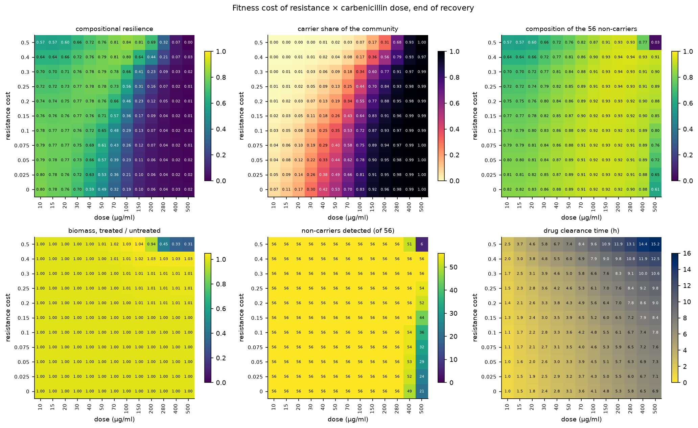
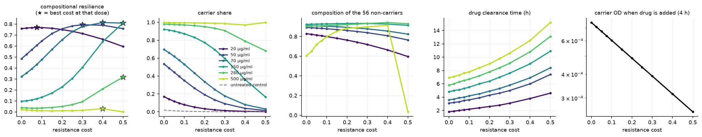
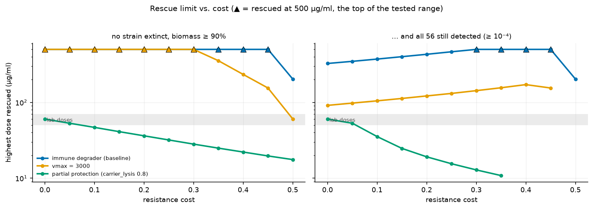
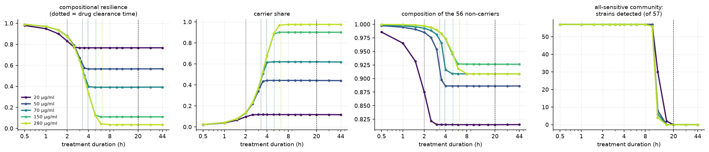
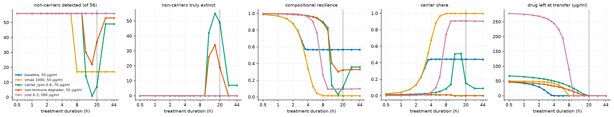
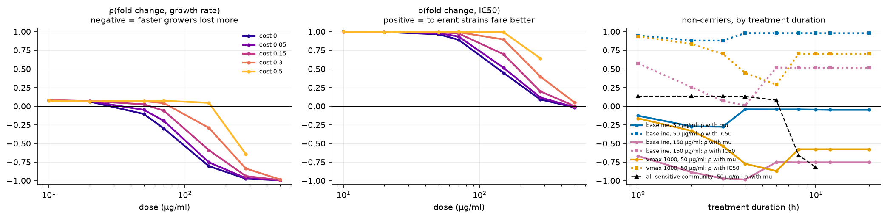

# Fitness cost of resistance and treatment duration

*Analysis of `resilience_model.py`, 16 Nov 2026. Notebook, CSVs and figures: `test_cost_and_duration/`.*

## Questions

1. How does the **fitness cost of resistance** (`resistance_cost`, the carrier's fractional loss of maximum growth rate) affect community recovery across carbenicillin concentrations?
2. How does the **duration of treatment** (`treatment_h`, the time from drug addition to the 1:100 transfer into drug-free medium) influence composition after recovery?

## Setup

- **Model:** unchanged; all 20 built-in checks pass.
- **Community:** 57 strains drawn with `seed = 42`; one immune, degrading carrier (k30).
- **Defaults:** `vmax = 10⁴`; drug added at 4 h.
- **Readouts:** taken 24 h after the transfer, against a matched untreated control on the same schedule.

The model's built-in `metrics` read at fixed clock times (48 h, and 24 h for some readouts), which are only correct when `treatment_h = 20`. The notebook therefore uses a schedule-relative `readouts()` helper, verified to match `metrics` exactly at the default schedule.

**Killing depends on growth rate.** As established for β-lactams, a susceptible strain's killing rate is proportional to its *current* growth rate:

`kill = gamma · f(drug/IC50) · g`, where `g = lag · mu · R/(K+R)`

So faster-growing strains die faster, killing stops when nutrient runs out, and cells in lag are spared (checks 5 and 20). Part 3 tests when this growth dependence decides which strains are lost.

---

## 1. Fitness cost × dose



**The cost changes composition far more than survival.**
- For the immune degrader, no non-carrier goes extinct anywhere on the 11-cost × 13-dose grid, except at cost 0.5 with ≥ 280 µg/ml.
- What the cost changes is how much the carrier takes over. At 50 µg/ml the carrier ends at 53% of the community with no cost, 44% at the baseline 0.05, and 9% at 0.3. Compositional resilience rises from 0.49 to 0.79 over the same range.



**Two opposing effects, both from slower carrier growth:**
1. **Less takeover** after the drug is gone.
2. **Less enzyme when the drug arrives.** A carrier paying 0.5 has about 3× less biomass at 4 h, so it clears the drug more slowly: 3.3 h → 7.4 h at 50 µg/ml, and up to 15 h at 500 µg/ml.

Which effect wins depends on dose, so **the best cost for composition rises with dose:**

| Dose (µg/ml) | Best cost | Compositional resilience at best cost | ... at cost 0.05 |
|---|---|---|---|
| 10 | 0 | 0.80 | 0.79 |
| 20 | 0.075 | 0.77 | 0.77 |
| 50 | 0.3 | 0.79 | 0.57 |
| 70 | 0.4 | 0.82 | 0.39 |
| 150 | 0.5 | 0.81 | 0.11 |
| 280 | 0.5 | 0.32 | 0.04 |
| 500 | 0.4 | 0.03 | 0.02 |

**Robustness across 12 trait draws:**
- best cost 0 at 20 µg/ml (range 0–0.2);
- 0.25 at 50 µg/ml (range 0.15–0.4);
- 0.5 at 150 µg/ml in every draw.

**Rescue limits.** Two definitions are used: *survived* means no strain extinct and biomass ≥ 90% of control; *detected* means, in addition, all 56 strains above 10⁻⁴.



| Carrier | Survival limit (cost 0 → 0.5) | Detection limit |
|---|---|---|
| Immune degrader | ≥ 500 µg/ml up to cost 0.45; 203 at 0.5 | *rises* with cost, 326 → ≥ 500 |
| `vmax = 3000` | ≥ 500 up to cost 0.3; then 355, 234, 155, 60 | rises, 91 → 172 |
| Partial protection (`carrier_lysis 0.8`) | falls steadily, 60 → 18 | falls, 60 → 11, then none |

- **Why detection improves with cost:** with a cheap carrier at high dose, strains are lost only below detection. They are alive but swamped by a carrier that makes up more than 99.7% of the community.
- **At the lab's doses, the cost cuts both ways depending on the carrier** (`05_cost_by_carrier_type.png`):

  | Carrier | Effect of a higher cost at 50–70 µg/ml |
  |---|---|
  | Immune degrader | helps: less takeover |
  | Five carriers | helps |
  | Weaker enzyme | helps |
  | Partial protection | ruins the rescue: 56 → 27 survivors at cost 0.15, 50 µg/ml; 7 at cost 0.05, 70 µg/ml |

**Answer to Q1.** The fitness cost trades rescue speed against takeover. When the rescue has margin (an immune carrier with enough enzyme), a higher cost improves recovery of community composition, and more so the higher the dose. When the rescue has no margin (partial protection, or very high dose with a very high cost), the cost turns rescue into collapse.

---

## 2. Treatment duration

**Protocol assumption.** As modelled, the transfer discards all remaining drug, and killing needs growth.



**With the baseline carrier, composition is set by the clearance time.**
- Compositional resilience falls from 0.99 (0.5 h treatment) to a plateau that starts at the clearance time: 0.57 from about 3.5–4 h at 50 µg/ml, and 0.11 from about 6 h at 150 µg/ml.
- After that it does not change, whether the transfer comes at 4, 20 or 44 h.
- The change is essentially all carrier enrichment.
- Across 12 draws, the plateau median is 4 h at 50 µg/ml and 6 h at 150 µg/ml, against median clearance times of 3.4 h and 5.3 h.

**The all-sensitive community has a duration threshold, not a dose threshold.**
- 56–57 strains are detected after up to 10 h of treatment, at any dose from 50 to 400 µg/ml.
- 4–8 strains remain at 12 h, and none from 16 h on.
- Above about 50 µg/ml, dose barely matters: killing is saturated at its growth-limited maximum (`gamma · g`).



**When the drug lingers, duration matters, and not monotonically.**

| Scenario | ≤ 8 h | 12–16 h | 20 h (protocol) | 30–44 h |
|---|---|---|---|---|
| Partial protection, 70 µg/ml | 56 survive | 42–55 extinct | 49 extinct | 7 extinct |
| Non-immune degrader, 50 µg/ml | 56 survive | 26–34 extinct | 19 extinct | 0 extinct |
| `vmax = 1000`, 50 µg/ml | 56 detected (≤ 4 h) | 17 detected, 0 extinct | 17 detected | 17 detected |

**Why the partial-protection and non-immune cases recover with long treatments:**
- The 1:100 transfer removes any strain with fewer than 100 cells.
- A transfer near the susceptible strains' minimum, while the drug is still being slowly cleared, catches them at the bottom.
- A longer treatment lets them regrow in the spent medium first.
- At 24 h the 20 h and 44 h runs are identical (non-carriers 3.2×10⁻⁶ OD). By the 44 h transfer the non-carriers have regrown to 0.8 OD.

**Cost and duration interact** (`11_cost_x_duration.png`). A costly carrier clears more slowly, which delays the plateau and widens the window in which transfer timing matters. At 150 µg/ml with cost 0.5:
- 8–12 h treatments leave biomass at only 0.25 and 0.07 of control;
- a 20 h treatment gives compositional resilience 0.81.

**Answer to Q2.** Treatment duration influences composition after recovery only until the drug is cleared. With an effective degrader that takes 3.5–6 h, and the protocol's 20 h is far past it. When clearance is slow, what matters is when the transfer bottleneck falls relative to clearance:
- before killing has done much: composition is preserved;
- near the trough: strains are lost;
- after regrowth: survivors are restored.

---

## 3. Who is lost: growth rate vs. IC50



Per-strain log fold change (treated ÷ untreated, surviving non-carriers only) is rank-correlated with each strain's intrinsic growth rate and with its IC50.

- **Moderate doses, fast clearance (≤ 70 µg/ml):** loss tracks **IC50** (ρ ≈ +0.9 to +1.0); growth rate has little effect (|ρ| ≤ 0.3).
- **High doses (≥ 150 µg/ml):** loss tracks **growth rate**: ρ = −0.75, −0.96 and −0.99 at 150, 280 and 500 µg/ml. Faster growers are lost preferentially. When every strain is far above its IC50, the dose-response term saturates and killing reduces to `gamma · g`.
- **Higher cost:** at 150 µg/ml, ρ with growth rate weakens from −0.75 (cost 0.05) to −0.29 (cost 0.3) and +0.05 (cost 0.5). A slower-clearing carrier leaves the drug in the IC50 range for longer on its way down.
- **Longer exposure:**
  - with a weak enzyme (`vmax 1000`, 50 µg/ml), ρ with growth rate goes from −0.16 at 1 h to −0.87 at 6 h;
  - for the all-sensitive community after 8–10 h at 50 µg/ml, ρ = −0.66 to −0.82.
- **Larger growth-rate spread** (`growth_cv` 0.2–0.3): strengthens the growth signal at 150–280 µg/ml, with no change at 50 µg/ml.

**Testable prediction.** In the barcode data, per-strain losses that correlate with each strain's growth rate rather than its MIC would indicate the drug stayed far above most MICs for a substantial time, that is, slow clearance.

---

## Caveats

- **Drug removal at transfer.** The transfer is modelled as removing all drug; a real 1:100 transfer carries over 1%.
- **Constant cost.** The cost is a constant growth penalty, with no dependence on growth phase or plasmid copy number.
- **Single trait draw for the full grids.** The grids use seed 42; key slices are checked on 12 draws.
- **No comparison with lab data.**
- **Readout timing.** The model's built-in `metrics` are clock-time based. Any analysis that changes `pregrowth_h`, `treatment_h` or `recovery_h` should use schedule-relative readouts, like the notebook's `readouts()` helper.

## Reproducing

```
cd updated_consumer_resource_model/test_cost_and_duration
jupyter nbconvert --to notebook --execute --inplace cost_and_duration.ipynb
```

Results are cached as CSVs in `cost_and_duration_results/`; delete them to recompute. Roughly 10–20 minutes from scratch, most of it the rescue-limit bisection.

**Environment.** Tested with Python 3.12, scipy 1.14.1, numpy 2.2 and pandas 3.1. With scipy 1.18 the model's LSODA solve fails at the baseline ("Unexpected istate in LSODA"), so `check()` itself does not run. Use scipy 1.14.1, the version these results were produced with, until that is resolved. Versions between 1.14 and 1.18 were not tested.
