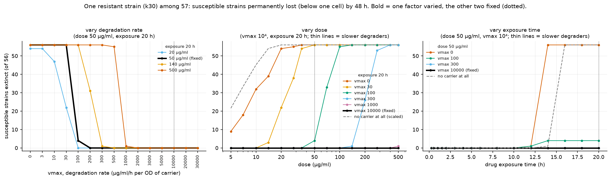
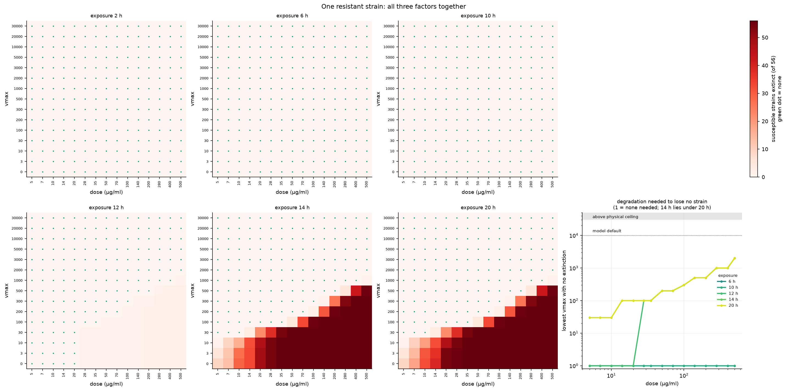
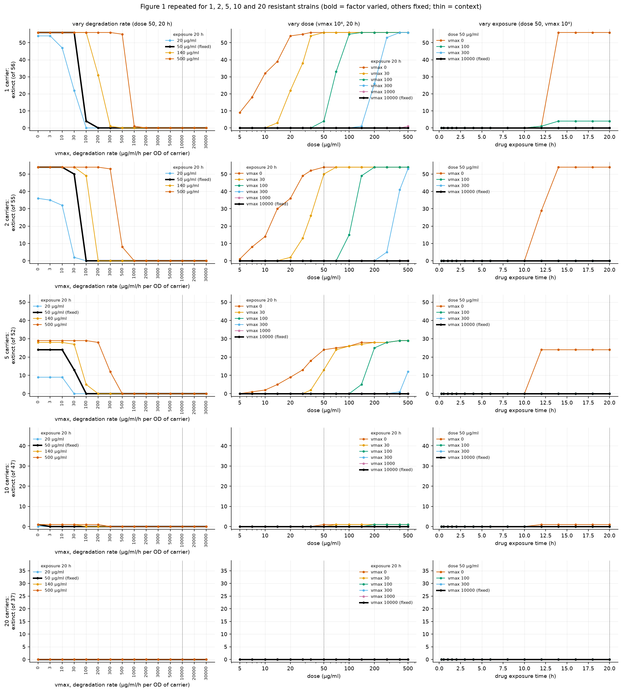
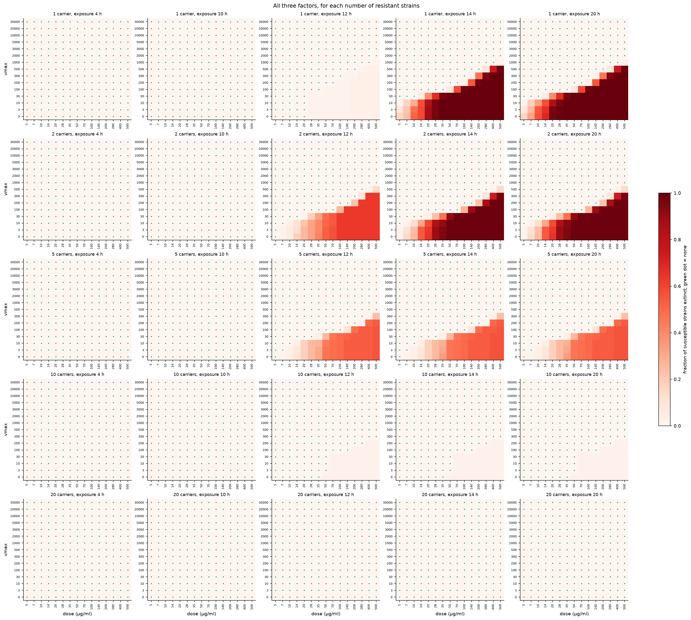
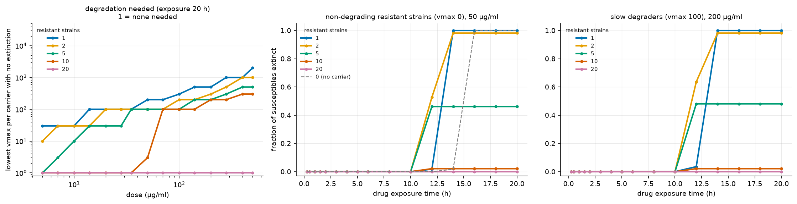
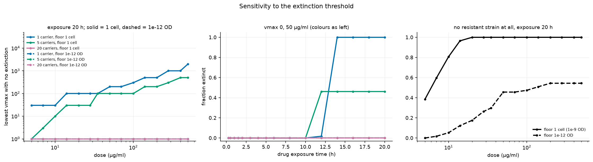

# When does antibiotic treatment permanently remove susceptible strains?

*Analysis of `resilience_model.py`, 16 Nov 2026. Code, CSVs and figures: `test_extinction_conditions/`.*

## Question and intuition

**Intuition being tested:**
- A highly resistant strain that does **not** degrade the antibiotic, or degrades it slowly, is the worst case for diversity: it survives, but the susceptible strains stay exposed.
- A resistant strain that degrades the drug **quickly** is the best case: it removes the drug before the susceptible strains are damaged.

**Question:** under what combinations of the following does treatment **permanently** reduce diversity, meaning susceptible strains go extinct?
- **dose**;
- **treatment (exposure) time**;
- **enzyme degradation rate**.

**Design:**
1. One resistant strain among 57. Vary each factor alone, then all three together.
2. Repeat with 2, 5, 10 and 20 resistant strains.

## Result in one paragraph

**The intuition holds.** Across 18,000 simulated conditions:
- extinction never increases with a faster degradation rate;
- extinction never decreases with a higher dose or a longer exposure.

A non-degrading resistant strain is the worst case: it loses all 56 susceptible strains at ≥ 35 µg/ml, and is even worse than having no resistant strain at all. A degrader at the model's default rate loses none, at any dose or exposure tested.

The model adds three things the intuition does not include:
1. **Exposure time is the strongest factor.** No strain is lost with ≤ 10 h of drug at any dose, because killing is capped by growth.
2. **Very little degradation is needed.** About 2% of the default rate suffices at 50 µg/ml.
3. **Many resistant strains protect even without degrading the drug,** by using up the nutrient so the susceptible strains stop growing and stop being killed.

---

## Assumptions (stated in full)

**The model**
1. **Community.** The model is `resilience_model.py`, unmodified, with every parameter at its default unless named here. 57 near-isogenic strains compete for one nutrient (Monod growth, `food` = 1 OD-equivalent). Strain growth rates (8% spread) and IC50s (median 5 µg/ml, lognormal spread 0.7) are drawn once with `seed = 42`.
2. **Killing requires growth.** Killing rate = `gamma · (a/IC50)^h / (1 + (a/IC50)^h) · g`, with `gamma` = 2.5, `h` = 2, and `g` the strain's *current* growth rate. Faster-growing cells die faster, and no growth means no killing (β-lactam behaviour). As a consequence, a population's net decline is at most (`gamma` − 1)·`g` ≈ 0.8 per hour, however high the dose.
3. **Resistant strains are fully immune** (`carrier_lysis` = 0, "highly resistant"). They pay a 5% growth cost (`resistance_cost` = 0.05) and do not lyse, so no free enzyme is released.
4. **Degradation.** Each resistant strain degrades the drug at `vmax · (carrier biomass) · a/(Km + a)`, with `Km` = 5.3 µg/ml (TEM-1). `vmax` is per OD of resistant biomass, so total degradation capacity scales with how much resistant biomass there is, which grows over time.
   - Model default: `vmax` = 10⁴ µg/ml/h/OD.
   - Estimated physical ceiling: ≈ 3×10⁴.
   - `vmax` = 0 is an immune strain that does not degrade at all.

**Protocol**

5. **Inoculation.** 0.005 OD total, split equally among the 57 strains. 4 h drug-free pre-growth, then the drug is added at `dose`.
6. **Exposure time.** The drug is **removed at 4 h + exposure time**: all remaining drug is set to zero, as if by a wash or excess β-lactamase, with cells and medium untouched. Exposure 20 h is the protocol, where the drug stays until the transfer.
   - This is not the same as changing the model's `treatment_h`, which also moves the transfer and the readout and so changes two things at once.
   - Here the transfer is always at 24 h and the readout at 48 h, so **only exposure time changes**.
   - Verified: exposure 20 h reproduces the model's own simulation exactly.
7. **Transfer.** At 24 h, 1:100 into fresh drug-free medium, then 24 h recovery. Readout at 48 h.

**Extinction**

8. **Extinction = fewer than one cell (10⁻⁹ OD, at 10⁹ cells per OD).** A strain is extinct once it falls below this, during growth or at the 1:100 transfer, and it never returns. Since 1 OD ≈ 10⁹ cells per ml, this floor is effectively one cell per ml, so it assumes a culture volume of about 1 ml.
9. **Why not 10⁻¹² OD.** That threshold is one-thousandth of a cell per ml. It would let a "0.02-cell" remnant survive the transfer and regrow, which is not physical. It was run as a sensitivity check (figure 6): with it, **no strain ever goes extinct** under any condition, which shows how much the answer depends on this choice (see Finding 6).
10. **Extinction is permanent.** No immigration, no new resistance, no persisters.
11. **Extinct is not the same as undetected.** Strains that are alive but below the 10⁻⁴ sequencing detection limit are counted separately as `undetected_alive`, not as extinct.
12. **Every extinction is caused by the drug.** Checked: no strain goes extinct in an untreated run with any number of resistant strains.

**Carriers and grid**

13. **Which strains are resistant.** 1 resistant strain is k30. For *k* resistant strains: k30 plus *k* − 1 others in a fixed random order, nested (the 5 include the 2, and so on). Each has the same `vmax` per OD and its own drawn growth rate.
14. **Ranges:**

    | Factor | Values | Fixed value when not varied |
    |---|---|---|
    | Dose | 5–500 µg/ml (15 values; the model's tested range) | 50 µg/ml (protocol) |
    | Exposure | 0.25–20 h (16 values) | 20 h (protocol) |
    | `vmax` | 0, 3, 10, … 30 000 (15 values) | 10⁴ (default) |

**Not included:** stochastic sampling at the transfer, spatial structure, persisters, drug carried over at transfer, plasmid transfer, β-lactamase inhibitors.

---

## 1. One resistant strain, one factor at a time

**(a) Degradation rate** (dose 50 µg/ml, exposure 20 h): extinction falls from all 56 strains at `vmax` 0 to none at `vmax` ≥ 200.

| `vmax` | 0–30 | 100 | 200 | ≥ 300 |
|---|---|---|---|---|
| Strains extinct (of 56) | 56 | 4 | 0 | 0 |

At 500 µg/ml the switch moves up to `vmax` ≈ 1 000–2 000. This is the intuition exactly: no or slow degradation is the worst case, and fast degradation protects everyone.

**(b) Dose** (`vmax` 10⁴, exposure 20 h): **no extinction at any dose from 5 to 500 µg/ml.** The default degrader clears even 500 µg/ml in about 7 h, before any strain is driven low.
- With slower degraders (thin lines), extinction rises with dose and saturates.
- A non-degrader loses 9 strains at 5 µg/ml (the most sensitive ones) and all 56 from 35 µg/ml.
- Dose matters only up to the point where every strain is far above its IC50 (≈ 35 µg/ml). Above that, killing is already at its growth-limited maximum and more drug adds nothing.

**(c) Exposure time** (dose 50 µg/ml, `vmax` 10⁴): **no extinction at any exposure.** With a non-degrader, extinction is a **sharp step**:

| Exposure | Strains extinct (non-degrader) |
|---|---|
| ≤ 10 h | 0 |
| 12 h | 1 |
| ≥ 14 h | all 56 |

**Why a step?** Killing can reduce a population by at most about 0.8 per hour (assumption 2).
- After 10 h the susceptible strains are about 10³–10⁴ times below where they started, still ~100 cells or more each.
- Once the drug is removed they regrow until the transfer and pass through the 1:100 bottleneck.
- After 14 h they are down to a few cells each. They cannot regrow enough before 24 h, and the transfer removes them all.

**A non-degrading resistant strain is worse than no resistant strain** (dashed grey). With it, everything is lost from 14 h of exposure. With no resistant strain, from 16 h. The immune strain survives the drug and takes the nutrient the susceptible strains need to regrow before the transfer.

## 2. One resistant strain, all three factors together

The extinction region (red) is **the corner with long exposure, high dose and slow degradation.**

**Exposure ≤ 10 h:** nothing is lost anywhere on the dose × `vmax` plane.

**Exposure ≥ 14 h:** the boundary is the same for all longer exposures. The lowest `vmax` that loses no strain rises roughly in proportion to dose:

| Dose (µg/ml) | 5–10 | 14–35 | 50–70 | 100 | 140–200 | 280–400 | 500 |
|---|---|---|---|---|---|---|---|
| Lowest safe `vmax` | 30 | 100 | 200 | 300 | 500 | 1 000 | 2 000 |

Even the highest of these is **5× below the model default** and 15× below the physical ceiling. A resistant strain only needs a small fraction of realistic β-lactamase activity to prevent any extinction.

**Exposure 12 h** is the transition: a few strains are lost wherever degradation is too slow.

## 3. More resistant strains (2, 5, 10, 20)

**At the protocol values** (50 µg/ml, 20 h, `vmax` 10⁴), no susceptible strain is lost for any number of resistant strains. Clearance time falls from 3.5 h with 1 resistant strain to 0.5 h with 20.

**With degraders,** more resistant strains need less degradation each. The lowest safe `vmax` per strain at exposure 20 h:

| Resistant strains | 50 µg/ml | 200 µg/ml | 500 µg/ml |
|---|---|---|---|
| 1 | 200 | 500 | 2 000 |
| 2 | 100 | 300 | 1 000 |
| 5 | 100 | 200 | 500 |
| 10 | 3 | 200 | 300 |
| 20 | 0 | 0 | 0 |

**What matters is total degradation capacity**, roughly `vmax` × resistant biomass, not degradation per strain.

**The exception to the intuition: many non-degrading resistant strains also protect.** With `vmax` = 0 at 50 µg/ml and long exposure:

| Resistant strains | 1 | 2 | 5 | 10 | 20 |
|---|---|---|---|---|---|
| Susceptible strains extinct | 100% | 98% | 46% | 2% | 0% |

These resistant strains do not touch the drug. They make up a large share of the inoculum (20 of 57 strains = 35%), grow unhindered, and use up the nutrient within a few hours. Because killing requires growth (assumption 2), the susceptible strains stop being killed once the nutrient is gone, even though the drug is still there.

**Checked:** with 5× more nutrient, the protection largely disappears. With 20 non-degrading resistant strains, 20 of 37 susceptible strains go extinct instead of 0.

This is a real consequence of β-lactams killing only growing cells (stationary-phase tolerance), not a bug. Its size depends on that assumption: if the drug also killed non-growing cells, this protection would shrink.

**The only departures from the expected direction** (67 of 18 000 slices) are all of this kind, at exactly 12 h of exposure, and mostly from 1 to 2 resistant strains. A second non-degrading resistant strain leaves less nutrient when the drug is removed (0.28 vs 0.64), so the susceptible strains cannot regrow enough before the transfer. With 1 resistant strain, 1 strain is lost; with 2, 29 are. This is the same nutrient-competition effect in the other direction, at a knife-edge exposure time. All 67 are listed in `extinction_results/intuition_violations_one_cell.csv`.

## 4. Where extinction happens, and why the threshold matters

**All extinction in these runs happens at the 1:100 transfer, never during the drug exposure itself.**
- The deepest any susceptible strain falls is about 2×10⁻⁹ OD (2 cells per ml), at 50 µg/ml and at 500 µg/ml alike.
- Strains that are still below about 100 cells when the transfer comes are lost in the dilution.
- So in this model, "permanent loss" means **too few survivors to pass the transfer bottleneck.**

**This is why the threshold matters so much.** With a 10⁻¹² OD floor, a strain at 2×10⁻⁹ OD becomes 2×10⁻¹¹ after dilution. That is still "alive", it regrows, and **nothing goes extinct anywhere on the grid**, not even the all-sensitive community after 20 h at 500 µg/ml. The one-cell floor is the physically meaningful choice, and the results above use it.

**Two consequences:**
1. Deterministic extinction depends on the culture volume (how many cells "one cell per ml" really is) and on the dilution factor.
2. A real transfer samples cells at random. A strain with ~100 cells has about a 37% chance (e⁻¹) of being lost even if the model says it survives. The model's boundaries are therefore optimistic near the edge. Bottleneck sampling is the most important missing piece for this question.

---

## Conclusions

1. **The intuition is right.** Across the whole grid, extinction never decreases with a higher dose or longer exposure and never increases with faster degradation. A non-degrading resistant strain is the worst case, worse even than no resistant strain. A fast degrader prevents all extinction.
2. **Permanent loss needs two things together:**
   - exposure of about **12–14 h or more**;
   - degradation slower than a dose-dependent threshold: `vmax` ≈ 30 at 5–10 µg/ml, 200 at 50, 2 000 at 500 (per OD of resistant biomass, one resistant strain).

   If either is missing, nothing goes extinct. Dose acts by moving the degradation threshold, not as a separate threshold. Even 5 µg/ml removes the 9 most sensitive strains if nothing degrades it. From about 35 µg/ml, all 56 are lost.
3. **Exposure time is the strongest lever.** Because β-lactams only kill growing cells, killing has a speed limit, and ≤ 10 h of drug never removes a strain at any dose.
4. **More resistant strains need less degradation each.** With 10 or more, a nearly or completely non-degrading set still protects by exhausting the nutrient. That protection depends on the "no growth, no killing" assumption.
5. **The default enzyme activity is far above what is needed to prevent extinction.** Any extinction in the lab at 50–70 µg/ml would therefore point to something the model lacks: much lower real activity, drug killing non-growing cells, persisters, or stochastic loss at the transfer.

## Files

| File | Contents |
|---|---|
| `test_extinction_conditions/scan.py` | simulation with drug removal at a set exposure time, reusing the model's integrator; `self_test()` checks it against the model |
| `run_scans.py` | the grids: 18 000 runs per threshold, plus the all-sensitive community |
| `intuition_checks.py` | monotonicity checks along every one-factor slice |
| `make_figures.py` | figures 1–6 and `min_safe_vmax.csv` |
| `extinction_results/` | `grid_one_cell.csv`, `grid_1e-12.csv`, `all_sensitive_*.csv`, `min_safe_vmax.csv`, `intuition_violations_*.csv`, `figures/` |

**To reproduce,** from `test_extinction_conditions/`, run `python run_scans.py`, then `python intuition_checks.py`, then `python make_figures.py`. The scans take about 6 minutes on 15 parallel workers. Results were produced with scipy 1.14.1; scipy 1.18 fails the model's baseline solve.
