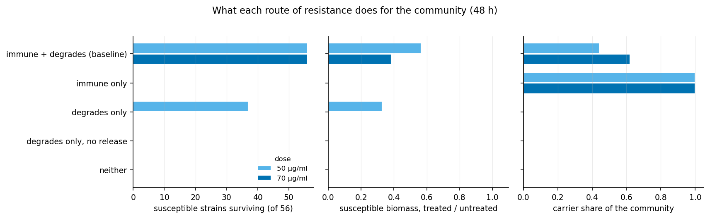
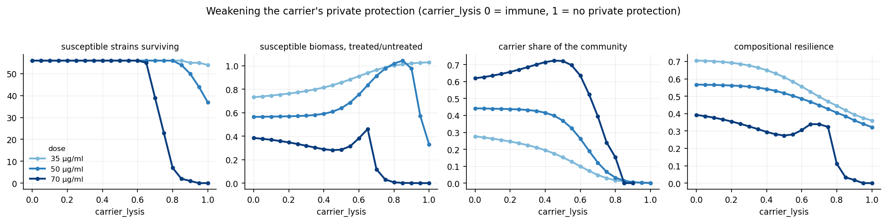
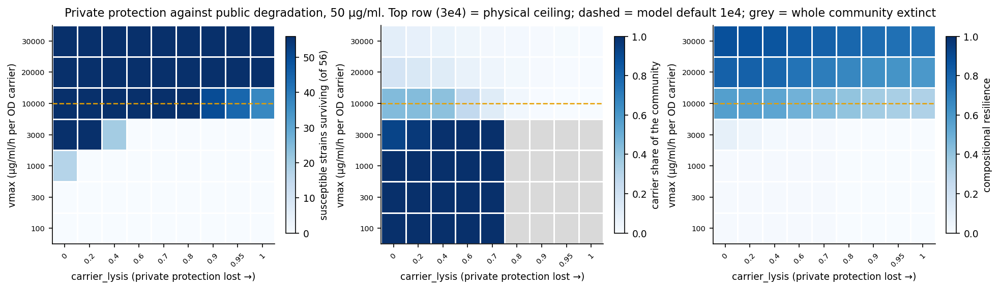
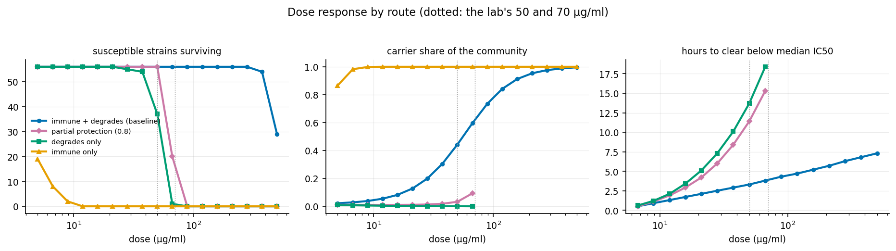
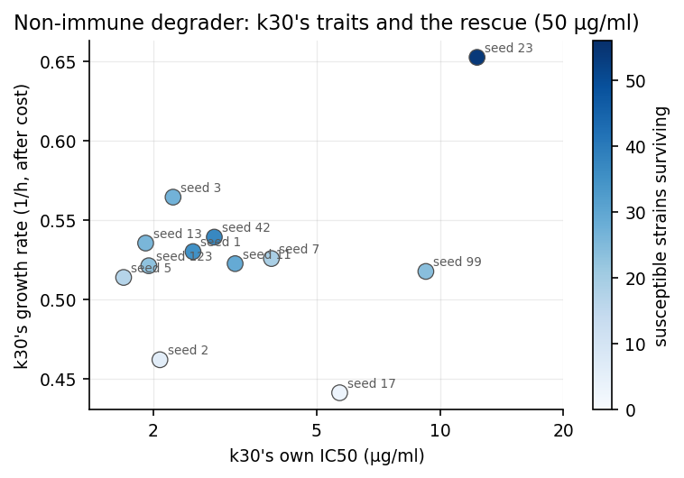
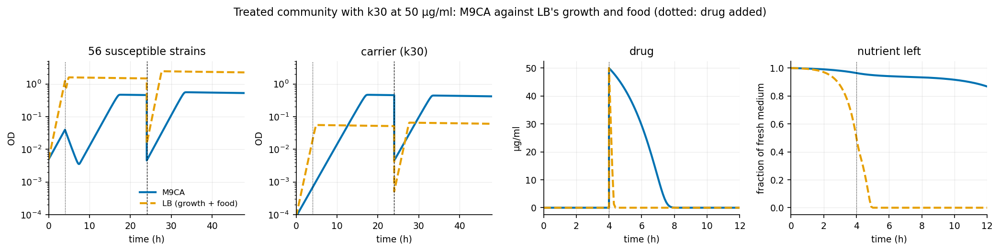
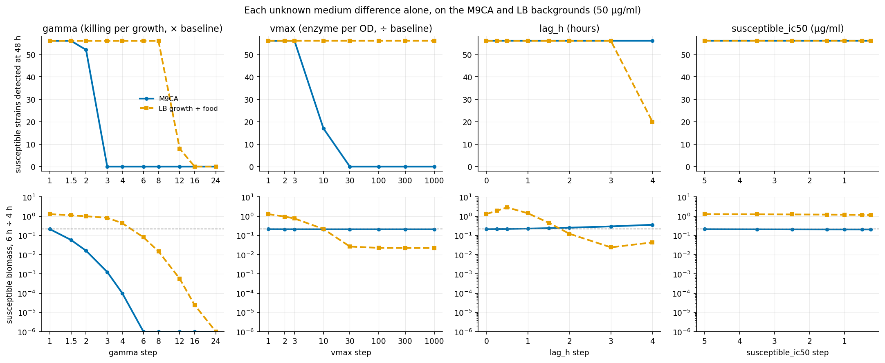
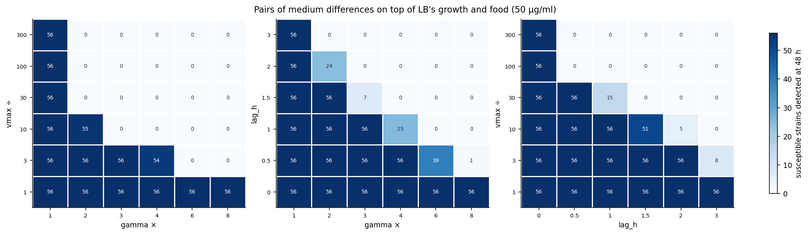
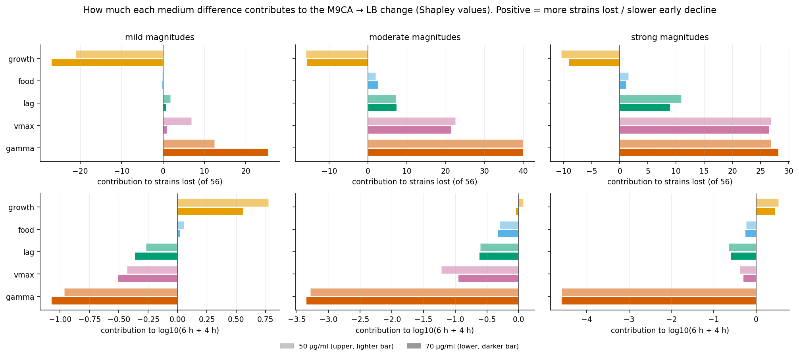
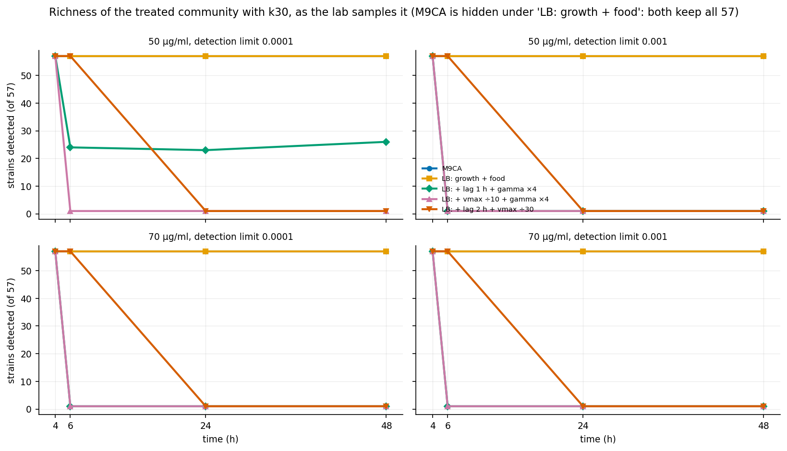

# Report: private vs. public benefit, and medium ablation (M9CA vs. LB)

This report covers two checklist items run on the consumer-resource model (`resilience_model.py`):

1. **Private vs. public benefit:** does k30 protect the community by surviving the drug (immunity) or by removing it (degradation)?
2. **Medium ablation:** which differences between LB and M9CA turn the M9CA outcome (recovery) into the LB outcome (faster decline and lower richness)?

Full analyses, with code, figures and CSVs:

| Test | Folder | Notebook | Results (CSVs, `figures/`) |
|---|---|---|---|
| Private vs. public | `test_protection_mechanism/` | `private_vs_public_protection.ipynb` | `protection_mechanism_results/` |
| Medium ablation | `test_medium_ablation/` | `medium_ablation.ipynb` | `medium_ablation_results/` |

All runs: 57-strain community, k30 as the only carrier unless stated, drug added at 4 h, 1:100 transfer at 24 h, readouts at 48 h, trait draw `seed = 42` unless stated, detection limit 10⁻⁴ relative abundance.

---

## 1. Model additions

The new terms follow the Ma et al. two-species model (Person 1–4 sweeps) and the Baranyi–Roberts lag model. **At their defaults the model reproduces the original to about 10⁻¹⁴**, so earlier results are unchanged.

| Parameter | Default | Meaning | Source of the form |
|---|---|---|---|
| `carrier_lysis` | 0 | Killing of a carrier relative to a susceptible cell. 0 = immune (original model), 1 = no private protection. | Ma et al. β (1 − β = private benefit) |
| `free_enzyme_activity` | 0.35 | Activity of β-lactamase released by lysed carriers, relative to cell-bound enzyme. | Ma et al. κ_b/φ_max |
| `enzyme_decay` | 0 /h | Inactivation rate of released enzyme. | Ma et al. (no decay apart from inhibitor) |
| `lag_h` | 0 h | Lag after inoculation and after transfer. Growth, and so killing, is reduced during lag. | Baranyi & Roberts 1994; tolerance by lag, Fridman et al. 2014 |

Equations, for carrier i and drug concentration a:

- carrier killing = `carrier_lysis` × (killing a susceptible cell with the same IC50 would get)
- dE/dt = (carrier biomass lysed per hour) − `enzyme_decay` × E
- da/dt = −vmax × (live carrier biomass + `free_enzyme_activity` × E) × a / (Km + a)
- growth multiplied by α(t) = 1 / (1 + (e^(μL) − 1) e^(−μ(t − t₀))), with t₀ = 0 h, then 24 h after transfer

New readouts: `protected_extinct` (strains truly gone, not just undetected), `protected_change_4_6h` (non-carrier biomass 6 h ÷ 4 h, the lab's panel), `drug_clearance_h`, `free_enzyme_at_24h`, `carrier_biomass_24h`, `carrier_survived`.

### Validation

- **Built-in checks: 20/20 pass** (15 original + 5 new). The new checks are:
  - a carrier with lysis 1 and no degradation behaves exactly like an ordinary strain;
  - free enzyme appears only when carriers are lysed;
  - carrier biomass falls monotonically as lysis rises;
  - lag matches the exact Baranyi formula;
  - cells in lag are killed less.
- **Stress test:** 144 runs across the full tested range of the new parameters, with no integration failures. Mass-balance error was at most 7 × 10⁻⁷.

---

## 2. Private vs. public benefit

### 2.1 Dissection

| Carrier type | Susceptible strains surviving, 50 µg/ml | 70 µg/ml | Carrier share at 48 h |
|---|---|---|---|
| Immune + degrades (baseline) | 56/56 | 56/56 | 0.44 / 0.62 |
| Degrades only (not immune) | 37/56 | 0/56 | rare |
| Degrades only, no enzyme release | 0/56 | 0/56 | — |
| Immune only (no degradation) | 0/56 | 0/56 | 1.0 |
| Neither | 0/56 | 0/56 | — |

- **Immunity alone protects no one.** The carrier simply inherits the community.
- **Degradation without immunity rescues partly, and only at 50 µg/ml.** Drug clearance takes 13.7 h, against 3.3 h for the immune degrader.
- **That rescue comes almost entirely from enzyme released by dying carriers.** Without release, the drug plateaus near 42 µg/ml and nobody survives.
- **Conclusion:** protection is a public good (drug removal), but its supply depends on a private good (immunity) that keeps the producer alive long enough.

### 2.2 Partial private protection

- **At 35 and 50 µg/ml there is a sweet spot.** Up to `carrier_lysis` ≈ 0.8, all 56 strains survive while the carrier's share falls from 0.44 to about 0.03, and susceptible biomass recovers fully (treated/untreated ≈ 1.0, up from 0.57).
- **At 70 µg/ml the window closes.** Strains are lost from `carrier_lysis` ≈ 0.65, and only 7/56 survive at 0.8.
- **Less takeover does not mean closer to the untreated composition.** Compositional resilience falls as private protection weakens, because slower clearance (3.3 h → 11.4 h) gives the drug longer to reshape the susceptible strains.

### 2.3 Private × public, the released-enzyme route, and dose

**Plausible range of `vmax`.** `vmax` is not measured, so the sweep is bounded by enzyme kinetics (worked in notebook section 3):

| Input | Value |
|---|---|
| TEM-1 share of cell protein with pUC19 | 1–2 % of total protein, about 5 × 10⁴ molecules per cell |
| TEM-1 turnover of carbenicillin | about 100 s⁻¹ |
| Cell density | 10⁹ cells/ml per OD |

Sources: Choury et al. 1999 for the Km and relative rate; Caniça et al. 1998 for the penicillin G kcat; the 1–2% expression level is attributed to Rinas & Bailey 1993 but was not checked against the full text. See `FINDINGS_SUMMARY.md`.

- **Ceiling:** these give about 1 × 10⁴ µg/ml/h per OD. Allowing for the uncertainty in the inputs, the ceiling is about 3 × 10⁴.
- **Realistic intact-cell range:** probably 10² to 10⁴, because the outer membrane slows the drug's entry into the periplasm.
- **Sweep range:** the model default (10 000) already sits at the ceiling. The sweep stops at 3 × 10⁴; an earlier version went to 10⁵, which is not physically attainable.

Results within that range:

- **Rescue needs degradation close to the ceiling.** An immune carrier rescues all 56 strains only from `vmax` ≈ 3 000 upward. It saves 17 at 1 000 and none at 300 or below. Either k30 works close to its kinetic maximum, or the model is missing another help to the community. Measuring k30's clearance rate per OD would settle this.
- **Near the ceiling, immunity and degradation substitute for each other:**
  - at 2–3 × 10⁴, all strains survive at every `carrier_lysis`;
  - at the default 10 000, strains are lost only above `carrier_lysis` 0.8;
  - at 3 000, only a nearly immune carrier (≤ 0.2) rescues everyone.
- **Faster degradation keeps the composition closer to untreated.** Compositional resilience for an immune carrier is 0.57 at the default, 0.81 at 2 × 10⁴ and 0.88 at 3 × 10⁴.
- **Released enzyme can fully replace immunity if it is active enough.** All 56 survive at `free_enzyme_activity` ≥ 0.5 (50 µg/ml) or ≥ 1 (70 µg/ml).
- **That route is fragile.** Enzyme decay of 0.03 /h (half-life about 23 h) cuts survivors from 37 to 8, and 0.1 /h removes the rescue.
- **Highest dose with full rescue:**
  - immune degrader: about 280 µg/ml
  - partial protection (0.8): 50 µg/ml
  - non-immune degrader: about 21 µg/ml
- **The lab's 50 vs. 70 µg/ml comparison sits where these routes diverge**, so it can tell the mechanisms apart.

### 2.4 Number of carriers and robustness

- **Two non-immune carriers already rescue every strain** at both doses. With four or more, community-level recovery beats the baseline, because non-immune carriers cannot take over.
- **The immune-degrader rescue is robust:** 56/56 in all 12 trait draws at both doses.
- **The non-immune result is not robust:** 3–54 survivors at 50 µg/ml (median 25) and 0–50 at 70 µg/ml (median 1). Seed 42 gives 37.
- **The outcome tracks k30's growth rate** (Spearman ρ ≈ 0.86, 12 draws) rather than its IC50 (ρ ≈ 0.27). A likely reason is that a faster-growing carrier has more enzyme when the drug arrives. Treat this as a strong hint, not a fitted relationship.

---

## 3. Medium ablation: M9CA vs. LB

**Lab result** (lab meeting 18 Sep 2026, slides 13–17), with k30 present:

- In LB, the non-k30 strains decline faster from 4 to 6 h than in M9CA.
- In LB, fewer strains are detected at 48 h.

A model scenario is called **lab-like** if it shows both, relative to the M9CA baseline. There is no LB preset: each difference is a separate switch.

| Difference | M9CA | LB value used | Evidence |
|---|---|---|---|
| `growth_mean` | 0.55 /h | 1.40 /h | model README, approximate |
| `food` | 1.0 | 2.5 | model README, approximate |
| `lag_h` | 0 h | 0.5–4 h | not measured |
| `vmax` (enzyme per OD) | 10 000 | ÷ 3 to ÷ 1000 | not measured |
| `gamma` (killing per growth) | 2.5 | × 2 to × 12 | not measured |
| `susceptible_ic50` | 5 µg/ml | lowered | not measured |

### 3.1 The known differences predict the opposite of the lab

| Readout (50 µg/ml) | M9CA | LB growth + food |
|---|---|---|
| OD at drug addition (4 h) | 0.04 | 1.25 |
| Drug clearance | 3.3 h | 0.3 h |
| Non-k30 biomass, 6 h ÷ 4 h | × 0.21 | × 1.28 |
| k30 share at 48 h | 0.44 | 0.03 |
| Compositional resilience | 0.57 | 0.96 |
| Strains surviving | 56/56 | 56/56 |

- **The model's LB culture is about 31× denser when the drug arrives**, so k30 clears the drug in minutes.
- **The cells run out of food about 1 h later and stop growing.** Killing needs growth, so they become tolerant.
- **Growth rate causes nearly all of this;** richer food alone barely matters.
- **So the model needs at least one further LB-specific difference.** Measuring OD at 4 h in LB would check this prediction directly.

### 3.2 One unknown at a time, then pairs

- **IC50 has no effect:** 50 µg/ml is far above every strain's IC50.
- **The M9CA community is fragile:** `gamma` × 2 loses 4 strains, `gamma` × 3 loses all of them, and `vmax` ÷ 10 leaves 17.
- **On the LB background, a single change must be large to lose strains:**
  - `gamma` must rise 12-fold, or
  - a 4 h lag is needed;
  - no reduction of `vmax` (down to ÷ 1000) loses any strain.
- **The faster early decline is easier to reproduce than strain loss:** `gamma` × 6, `vmax` ÷ 30 or a 2 h lag suffices on LB.
- **Lag acts in opposite directions in the two media.** In M9CA it only adds tolerance. In LB a long lag delays growth until the drug is present.

**Pairs are strongly synergistic.** On LB, `gamma` × 4 alone and `vmax` ÷ 10 alone lose nothing, but together they lose all 56. A 1.5 h lag with `vmax` ÷ 30 also loses all 56, and `gamma` × 3 with a 1.5 h lag leaves 7.

### 3.3 Full factorial with Shapley attribution

- **Design:** five switches (growth, food, lag, vmax, gamma), all 2⁵ = 32 combinations, at both doses and at three assumed magnitudes:

  | Set | lag | vmax | gamma |
  |---|---|---|---|
  | mild | 0.5 h | ÷ 3 | × 2 |
  | moderate | 1 h | ÷ 10 | × 4 |
  | strong | 2 h | ÷ 30 | × 8 |

- **Attribution:** each switch's Shapley value is its effect averaged over every combination of the other switches. The five values add up exactly to the full M9CA → LB difference.

- **Growth rate is always protective** (−9 to −27 strains lost), and food contributes almost nothing.
- **`gamma` is the largest contributor to strain loss** at mild and moderate magnitudes (12–40 strains) and ties with `vmax` at strong magnitudes (about 27 each). Lag contributes 1–11.
- **`gamma` dominates the early 4 → 6 h decline in every set** (−1.0 to −4.6 log₁₀ units), several times the contribution of `vmax` or lag.
- **The ranking is the same in all three magnitude sets**, even though the Shapley values themselves depend on the assumed magnitudes.

### 3.4 Extinct, or just below detection?

| Lab-like scenario (50 µg/ml) | Detected at 10⁻⁴ | Truly extinct |
|---|---|---|
| LB + lag 1 h + `gamma` × 4 | 26 of 57 | 0 |
| LB + `vmax` ÷ 10 + `gamma` × 4 | — | 31 (all 56 at 70 µg/ml) |
| LB + lag 2 h + `vmax` ÷ 30 | k30 only | 0 |

- **Missing strains are not always lost strains.** When k30 is over 99% of the community, the others can be alive but undetectable, and they stay hidden at 48 h too.
- **"Persistent loss" by itself does not separate extinction from dominance.** They point to different mechanisms:
  - extinction needs slow drug clearance and strong killing;
  - dominance can arise from lag.

### 3.5 Robustness across trait draws (12 draws)

- **M9CA and LB growth + food keep all 56 strains** in every draw, at both doses.
- **LB + `vmax` ÷ 10 + `gamma` × 4 is lab-like in 12/12 draws** at both doses, by extinction (median 41.5 extinct at 50 µg/ml).
- **LB + lag 2 h + `vmax` ÷ 30 is lab-like in 12/12 draws** at both doses, by dominance (median 0 extinct).
- **LB + lag 1 h + `gamma` × 4 is lab-like in 11/12 draws at 50 µg/ml and 12/12 at 70**, but detected richness varies widely (5–56).

---

## 4. Conclusions

**Private vs. public**

1. **Degradation is what protects the others; immunity keeps it going.** Immunity alone never helps the others. Degradation alone helps only at lower doses, mostly through enzyme released when carriers die.
2. **Protecting and taking over trade off.** A partly protected carrier can rescue everyone with almost no takeover at 35–50 µg/ml, but not at 70 µg/ml.
3. **The lab's 50 vs. 70 µg/ml comparison discriminates mechanism.**

**Medium ablation**

1. **LB's known differences (faster growth, more food) predict better recovery in LB**, which contradicts the lab.
2. **Reproducing the lab takes either one large change or two moderate ones.** The single changes are `gamma` × 12 or a 4 h lag. Moderate pairs also work, such as `gamma` × 4 with `vmax` ÷ 10.
3. **Higher killing per unit growth in LB is the leading candidate**, especially for the faster early decline.
4. **The lab's richness drop could be extinction or dominance below detection.**

## 5. Suggested measurements

| Unknown | Measurement |
|---|---|
| Density and growth at drug addition | community growth curves in each medium; OD at 4 h |
| `gamma` (killing per growth) | time-kill curves of the all-sensitive community in each medium, normalized by growth rate |
| `vmax` (enzyme per OD) | carbenicillin clearance by k30 alone in each medium, per OD (bioassay or nitrocefin) |
| `free_enzyme_activity`, `enzyme_decay` | supernatant β-lactamase activity during treatment and its decay afterwards |
| Degradation without immunity | add purified TEM-1 or sterile k30 supernatant to the all-sensitive community |
| Immunity without degradation | a carrier resistant through a non-degrading mechanism at matched MIC |
| Extinct vs. undetected | absolute barcode abundances at 48 h (spike-in standard or qPCR) |

## 6. Limits

- **Assumed values:** the LB values of lag, `vmax` and `gamma` are assumptions, not measurements.
- **`vmax` is unmeasured,** and its default (10 000) sits at the estimated kinetic ceiling, so the baseline protection may be optimistic.
- **Model structure:**
  - The model is deterministic and well mixed, with no spatial structure and no replicate noise.
  - All strains share one lag and one `gamma`.
- **Partial protection** is a constant fraction (Ma et al.'s β), not a shift in the carrier's IC50, so the checklist's "partial resistance" item is only partly covered.
- **Trait-draw dependence:** results for non-immune carriers depend strongly on the draw.
- **Biology:** TEM-1 is periplasmic, so "degrades only" is a conceptual dissection, not a strain that can be built directly.
